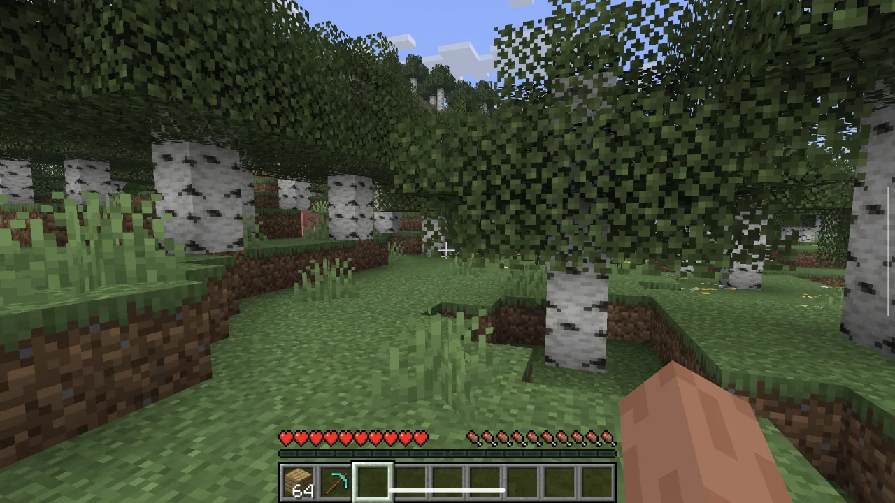
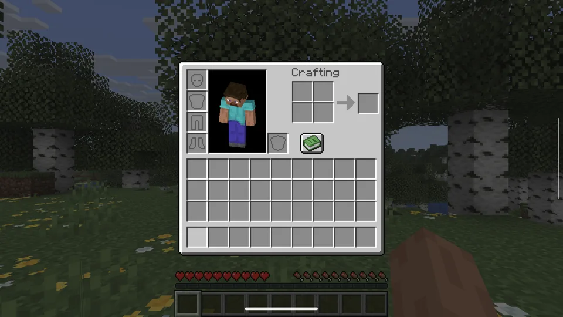
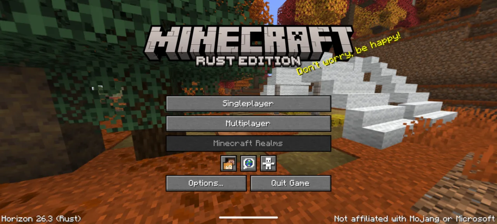
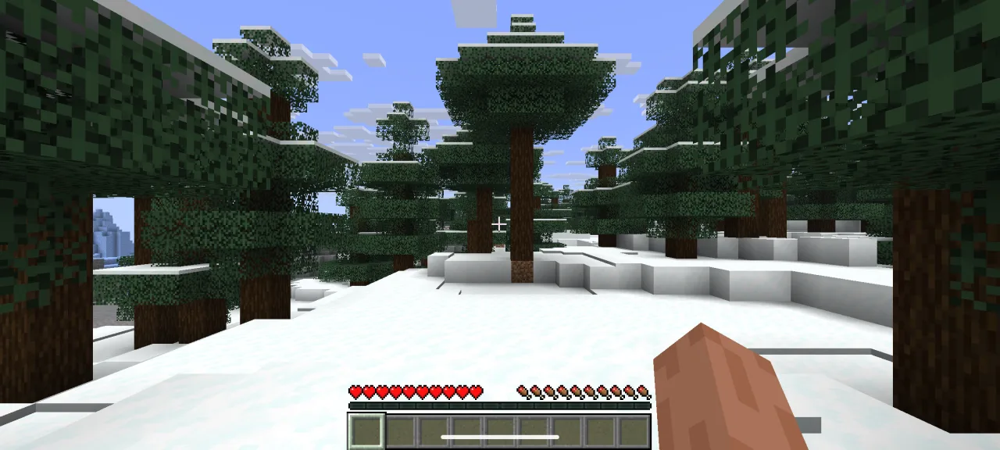

# Horizon for Android

[Horizon](https://github.com/ludovic111/horizon), Minecraft: Java Edition 26.3 rewritten in Rust, built for Android: arm64, Vulkan, Android 11 or later.

**[Download the latest APK](https://github.com/yowmamasita/horizon/releases/latest)**

> Not an official Minecraft product. Not approved by or associated with Mojang or Microsoft. Horizon contains no Minecraft code, assets or data: you need your own legally obtained copy of Minecraft: Java Edition 26.3.

<table>
  <tr>
    <td width="50%"></td>
    <td width="50%"></td>
  </tr>
  <tr>
    <td width="50%"></td>
    <td width="50%"></td>
  </tr>
</table>

## Install

The APK holds no Minecraft files. You prepare them once on a computer from your own copy of the game, then copy them to the device.

1. **Prepare the files** on a computer with Rust, JDK 25 and Minecraft: Java Edition 26.3 played once in the official launcher:

   ```sh
   git clone https://github.com/yowmamasita/horizon.git
   cd horizon
   cargo run --release -p horizon-prepare -- --prepare --server-jar ~/Downloads/server.jar
   cargo run --release -p horizon-prepare -- sounds   # optional: without it the game is silent
   ```

   The server jar is the 26.3 one, from the `downloads.server.url` in your launcher's `versions/26.3/26.3.json`. If your game folder is not the launcher's default, pass `--minecraft-dir`. Everything lands in `.local/horizon-client/26.3` (about 700 MB with sounds). It is derived from the game: never share it.

2. **Install the APK and copy the files** with adb:

   ```sh
   adb install horizon-android-arm64.apk
   adb push .local/horizon-client/26.3 /sdcard/Android/data/dev.horizon.android/files/.local/horizon-client/26.3
   # Android 16 and later: let the app into the folders adb created
   adb shell chmod -R a+rX /sdcard/Android/data/dev.horizon.android/files/.local
   ```

3. **Start Horizon** from the app drawer.

## Controls

- **Controller:** plays as on the desktop, with the built-in controller of a handheld such as the AYN Odin 3, or a paired pad. A jumps, Y opens the inventory, the right trigger breaks, the left trigger uses and places, the bumpers change the hotbar slot, Start pauses.
- **Touchscreen:** works as the mouse in menus.
- **Back:** is Escape: pause, leave a menu.

There are no touch controls in the world yet, so a phone needs a controller to play. The world is saved when the app goes to the background.

## Tested devices

| Device | GPU | Title screen to world | Frame rate (render distance 12, Fancy) |
|---|---|---|---|
| AYN Odin 3 (Android 15) | Adreno 830 | about 25 s for a new world | 60 fps with VSync, 119 fps without (the 120 cap) |
| Pixel 6 (Android 16) | Mali-G78 | about 35 s for a new world | 60 fps with VSync |

**Not yet:** touch controls in the world, the system clipboard (copy and paste stay inside the game), controller rumble, code mods.

## Build the APK

Every push to the `android` branch builds the APK and publishes it as the latest release ([`android.yml`](.github/workflows/android.yml)). To build it yourself, with the Android NDK, build-tools 35 and `cargo-ndk`:

```sh
rustup target add aarch64-linux-android
cargo ndk -t arm64-v8a -P 30 -o crates/horizon-android/lib build --release -p horizon-android
crates/horizon-android/build-apk.sh   # writes crates/horizon-android/horizon.apk
```

How the port works:

- [`crates/horizon-android`](crates/horizon-android) builds the desktop client's game code as a NativeActivity library.
- [`android_main.rs`](crates/horizon-client/src/android_main.rs) is its entry point.
- [`third_party/winit`](third_party/winit) is winit 0.30.13, patched to keep the game controller's input and to send Back as Escape.

## Licence

[MIT](LICENSE), for the project's original work only. Dependencies keep their own licences ([third-party notices](THIRD_PARTY_NOTICES.md)). Minecraft is a trademark of Mojang Synergies AB; Minecraft code and assets belong to Mojang and Microsoft and are covered by the [Minecraft EULA](https://www.minecraft.net/en-us/eula).

Horizon is made by [Ludovic Marie](https://lu4ovic.com) ([@ludovic111](https://github.com/ludovic111)). This fork adds the Android build.
